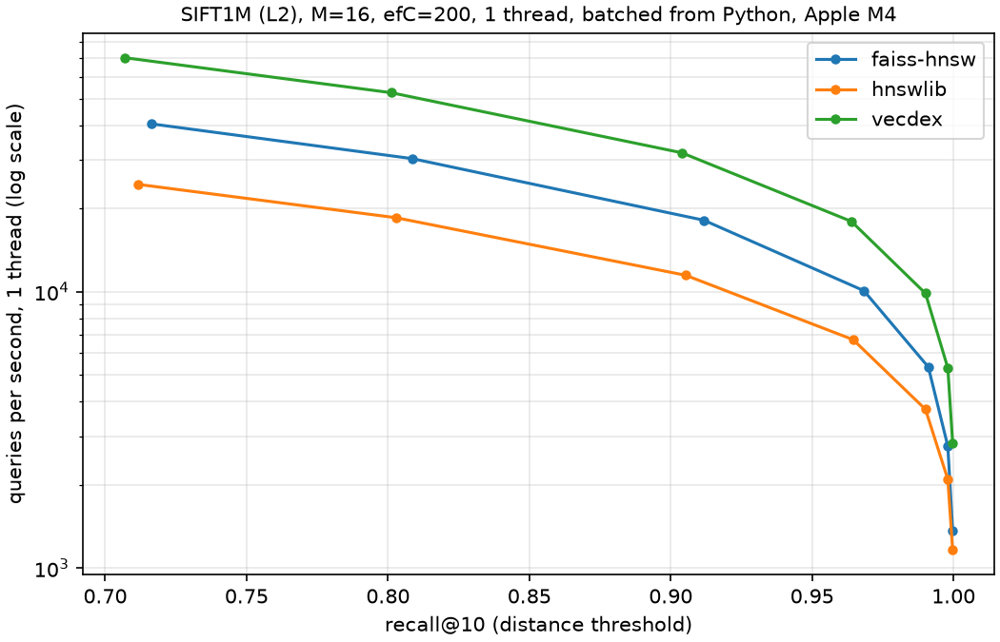
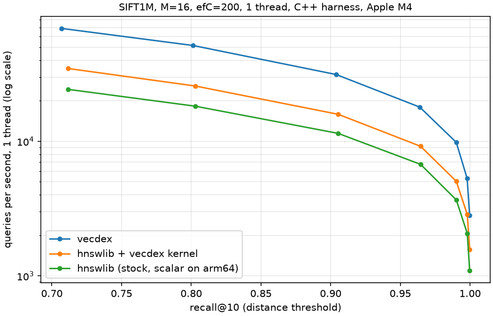

# vecdex

[](https://github.com/MatiiiBL/HNSW_vector_search/actions/workflows/ci.yml)

**Approximate nearest-neighbor (ANN) vector search in C++20**, built around
[HNSW](https://arxiv.org/abs/1603.09320) graphs, with SIMD distance kernels, a multithreaded
build, crash-safe save/load, zero-copy NumPy bindings, and a retrieval-augmented generation (RAG)
demo. It is benchmarked against hnswlib and FAISS on the same machine, with the same harness and
the same build parameters.

On SIFT1M (1M × 128), on one core of an Apple M4:

- **18,000 queries/s at 96.4% recall@10.** That is 1.98× this project's own first working
  version, mostly from software prefetching, which a profile pointed to.
- **1.96× hnswlib** using the *same* NEON distance kernel, **2.66× stock hnswlib** (whose SIMD
  and prefetch code is compiled out on ARM), and **1.78× FAISS HNSW**, all at recall@10 ≥ 0.95
  with the same build parameters.
- **A 1M-vector build in 142 s on one thread, and 28 s on 10.** It uses per-node locks, recall
  doesn't change, and ThreadSanitizer finds no races.
- **A 650 MB index reloads in 0.44 s,** checksummed and validated as untrusted input (fuzzed with
  libFuzzer).



## Contents

- [Results](#results)
- [Quick start](#quick-start): C++, Python, the RAG demo
- [How it works](#how-it-works)
- [Design decisions](#design-decisions)
- [Testing](#testing)
- [Benchmark methodology](#benchmark-methodology)
- [Limitations and next steps](#limitations-and-next-steps)

## Results

All numbers were measured on a 13" MacBook Air M4 (4 performance + 6 efficiency cores, 16 GB,
macOS 27, Apple clang 21, `-O3`, no `-ffast-math`), plugged in, one benchmark at a time, with
no builds or other workloads running. Build
parameters are M = 16 and efConstruction = 200 for every library. QPS is the median of 5 timed
passes over the 10,000 queries, after a warmup pass. Recall is recall@10 by distance threshold, as
in ann-benchmarks. The raw CSVs are in [`bench/results/`](bench/results/).

### vecdex vs hnswlib, same harness (C++, single thread)

`vecdex_eval` runs every library through the same loading, timing and recall code.
`hnswlib + vecdex kernel` plugs vecdex's NEON distance function into hnswlib, so that comparison
is graph code against graph code.

| ef | recall@10 (vecdex / hnswlib) | vecdex | hnswlib + vecdex kernel | hnswlib (stock) |
|---|---|---|---|---|
| 16 | 0.801 / 0.803 | **51,576** | 25,782 | 18,253 |
| 32 | 0.904 / 0.905 | **31,382** | 15,898 | 11,466 |
| 64 | 0.964 / 0.965 | **17,964** | 9,190 | 6,746 |
| 128 | 0.990 / 0.990 | **9,830** | 5,051 | 3,674 |
| 512 | 1.000 / 1.000 | **2,815** | 1,573 | 1,094 |
| **Build, 1 thread** | | **142 s** | 254 s | 357 s |
| **Index size** | | 674 MB | 661 MB | 661 MB |

Queries per second, one thread. Both libraries build equally good graphs: recall at each ef
agrees to within 0.005.



**Why vecdex is faster, and why the stock number isn't the headline.** On arm64, hnswlib 0.8.0
compiles its SIMD distance functions and every `_mm_prefetch` out (`#ifdef USE_SSE`), so stock
hnswlib on a Mac runs a scalar distance loop with no prefetching. With the same kernel, the
remaining gap is graph-traversal code, and the numbers point at one thing: hnswlib with vecdex's
kernel (9,190 QPS at ef = 64) runs almost exactly as fast as vecdex did *before* prefetching
(9,074 QPS, next table). Prefetching all of a node's unvisited neighbors before computing any
distance is what doubles vecdex's speed, and on ARM hnswlib has no prefetching at all. On x86, where hnswlib's prefetching is active, the gap may be smaller. That wasn't
measured here.

### Where the speed came from

| Version | SIFT1M build | QPS at ef = 64 (recall 0.964) | vs. baseline |
|---|---|---|---|
| Baseline (first working HNSW) | 254 s | 9,074 | 1.00× |
| + pooled search buffers (no allocation per query) | 242 s | 9,455 | 1.04× |
| + software prefetch of neighbor vectors | 142 s | 17,999 | 1.98× |
| Final (after save/load, threading, bindings) | 143 s | 17,972 | 1.98× |

Each row is the mean of two runs, taken in the order A B C D D C B A so that slow thermal drift
cancels. The two runs of each version agree within 2%. A sampling profile of the baseline put
96% of search time in the layer search and the distance kernel. The kernel's share was mostly
waiting on memory: each expanded node touches about 21 random 512-byte vectors out of 512 MB, a cache miss
apiece. Prefetching all of them before computing any distance lets the misses overlap. Against the
version before it, that nearly halved the time per query (1.90×) and cut the build time by 41%.

### Save and load

| | SIFT1M index (650 MB) |
|---|---|
| Save (write, `F_FULLFSYNC`, atomic rename, directory sync), one run | 0.41 s |
| Load (read, XXH64 checksum, full graph validation), warm page cache, median of 3 | 0.44 s |

Loading the saved index and saving it again gives a byte-identical file, from C++ and from
Python.

### Multithreaded build and batch search

| Threads | Build | Speedup | Batch QPS (ef = 64) | Speedup | recall@10 |
|---|---|---|---|---|---|
| 1 | 143 s | 1.0× | 17,964 | 1.0× | 0.9639 |
| 2 | 81 s | 1.8× | 32,853 | 1.8× | 0.9639 |
| 4 | 46 s | 3.1× | 55,938 | 3.1× | 0.9640 |
| 6 | 38 s | 3.8× | 65,758 | 3.7× | 0.9641 |
| 8 | 31 s | 4.7× | 81,080 | 4.5× | 0.9638 |
| 10 | 28 s | 5.1× | 87,494 | 4.9× | 0.9639 |

The M4 has 4 performance and 6 efficiency cores, and the curve shows it: 3.1× on 4 threads.
After that each added thread is a slower efficiency core sharing the same
memory system, so 10 threads give about 5×. Threads claim nodes from a shared counter, so slow
cores take fewer nodes instead of holding up the end. A parallel build's graph depends on thread
timing, but its recall matched the serial build in every run.

### Against FAISS and hnswlib from Python

Each library runs in its own process, on one thread (FAISS with `omp_set_num_threads(1)`), with
batched queries and the same M = 16 and efConstruction = 200. QPS is read at the smallest ef
that reaches each recall target. That's fairer than comparing at equal ef, because FAISS's graph
gets slightly higher recall per ef.

| SIFT1M, from Python | QPS at recall ≥ 0.90 | ≥ 0.95 | ≥ 0.99 | Build | Index size |
|---|---|---|---|---|---|
| **vecdex** | **31,813** | **17,958** | **9,858** | **141 s** | 674 MB |
| FAISS `IndexHNSWFlat` 1.15 | 18,138 | 10,083 | 5,340 | 246 s | 656 MB |
| hnswlib 0.8.0 (pip) | 11,465 | 6,706 | 3,752 | 355 s | 661 MB |

Index size is each library's own report (vecdex's `memory_bytes()`, hnswlib's file size, FAISS's
serialized size), so it's comparable only roughly. In all three, the vectors take 512 MB of
it.

### Python binding overhead

`knn_query` called with all 10,000 queries in one array costs **0.3 to 3 µs per query** more
than the C++ loop (less than 2% at ef = 64). One query per call costs 0.6 to 4 µs. At 4 and 10
threads, Python's batch search is within noise of C++'s (61,752 vs 59,521 QPS at ef = 64 on 4
threads). Adds pass the NumPy buffer to C++ without copying it. A test of peak memory during an
add measures 1.00× the batch, versus 2.0× when the old staging copy is restored.

### The RAG demo

Retrieval over the 2,067 Wikipedia paragraphs of SQuAD v1.1 dev, embedded with
`all-MiniLM-L6-v2` (384-d, cosine), for all 10,570 questions:

| Retriever | recall@10 vs exact | right paragraph at #1 | in top 10 |
|---|---|---|---|
| FAISS flat (exact) | 1.0000 | 0.6229 | 0.9167 |
| FAISS HNSW | 0.9985 | 0.6226 | 0.9156 |
| vecdex | 0.9980 | 0.6224 | 0.9149 |

## Quick start

### C++

Requires CMake ≥ 3.25, Ninja and a C++20 compiler (developed with Apple clang 21; CI also uses
GCC 14 and Clang 18). Dependencies (GoogleTest, Google Benchmark, hnswlib) are downloaded and
pinned by checksum.

```sh
cmake --workflow --preset asan      # Debug + AddressSanitizer + UBSan, then the tests
cmake --workflow --preset tsan      # ThreadSanitizer
cmake --workflow --preset release   # -O3, with the benchmarks
```

```cpp
#include <vecdex/vecdex.hpp>

auto base = vecdex::read_fvecs("data/sift/sift_base.fvecs");

vecdex::HnswIndex index(base.dim(), vecdex::Metric::L2, {.M = 16, .ef_construction = 200});
index.add(base, /*num_threads=*/8);

// The 10 approximate nearest neighbors, closest first, as {squared distance, id}.
// ef (here 64) is the recall-versus-speed dial: higher is more accurate and slower.
std::vector<vecdex::Neighbor> hits = index.search(base.row(0), 10, 64);

index.save("sift.vdx");                              // atomic and durable
auto again = vecdex::HnswIndex::load("sift.vdx");    // validated as untrusted input
```

Datasets aren't committed. `scripts/download_siftsmall.sh` (5 MB, used by the tests),
`scripts/download_sift1m.sh` (160 MB) and `scripts/download_glove100.sh` (GloVe-100 from
ann-benchmarks) fetch them and verify their SHA-256.

```sh
build/release/bench/vecdex_eval data/sift sift                        # recall/QPS sweep, CSV
build/release/bench/vecdex_eval data/sift sift --lib hnswlib-vecdex-kernel
build/release/bench/vecdex_eval data/sift sift --threads 10 --save sift.vdx
```

### Python

```sh
python3 -m venv .venv && . .venv/bin/activate
pip install .                    # builds the extension with scikit-build-core + pybind11
```

```python
import numpy as np
import vecdex

vectors = np.random.default_rng(0).standard_normal((10_000, 128), dtype=np.float32)
index = vecdex.Index("cosine", dim=128, M=16, ef_construction=200)
index.add_items(vectors, num_threads=4)               # read in place, no copy
labels, distances = index.knn_query(vectors[:5], k=10)
index.save("vectors.vdx")
```

Inputs must be float32 and C-contiguous: they're read in place, and nothing is converted behind
your back. Both calls release the GIL. See [`python/README.md`](python/README.md).

### The RAG demo

```sh
examples/rag/run.sh    # venv, pinned deps, corpus, embeddings, then the retrieval report
```

See [`examples/rag/README.md`](examples/rag/README.md).

## How it works

```
include/vecdex/     public API: HnswIndex, BruteForceIndex, Matrix/MatrixView, distance, I/O
src/
  hnsw.cpp          build (Algorithms 1 and 4 of the paper) and search (2 and 5), parallel add
  hnsw_io.cpp       save/load: versioned format, XXH64, validation (docs/FORMAT.md)
  search_scratch.hpp  pooled per-search memory: epoch-stamped visited marks and the heaps
  kernels_*.cpp     scalar / NEON / AVX2 distance kernels, chosen at runtime
python/             pybind11 bindings (vecdex.Index)
bench/              vecdex_eval (C++ harness, with hnswlib), compare/ (Python, with FAISS)
examples/rag/       the RAG demo
tests/              GoogleTest suite, fuzz target
```

- **The graph.** Every vector is a node on layer 0; a random, exponentially thinning fraction
  also lives on layers 1, 2, …, like a skip list. A search walks greedily down the sparse upper
  layers, then runs a bounded best-first search on layer 0, where `ef` trades recall for speed.
  Neighbor selection uses the paper's diversity heuristic, as hnswlib does.
- **Memory layout.** Vectors live in one contiguous row-major buffer. Layer-0 links are
  fixed-size blocks in one flat array, so following a link never chases a per-node allocation.
  Ids are 32-bit.
- **The hot loop.** For each expanded node: filter the unvisited neighbors (an epoch-stamped
  visited array, O(1) to reset), prefetch all their vectors, then compute distances with the NEON
  kernel and update two heaps that live in pooled scratch memory. A warm search allocates only
  the vector it returns.
- **Concurrency.** Searches are lock-free and may run in parallel. A parallel build stores every
  vector first, then threads claim nodes from an atomic counter. Each node's links are guarded by
  its own mutex, a thread never holds two node locks, and a node becomes reachable only after its
  own links are written. A compile-time policy keeps the locking code out of `search()`
  entirely.

## Design decisions

- **Same harness for every library.** Comparing against a library in its own benchmark script
  measures the scripts as much as the libraries. `vecdex_eval` and `bench/compare` run every
  library through identical timing and recall code.
- **Distance-threshold recall.** SIFT1M's ground truth breaks distance ties arbitrarily, so even
  exact search scores 0.9995 by id. Counting any result within the k-th true distance (plus a
  relative 1e-5 for float rounding) scores exact search 1.0, as ann-benchmarks does.
- **Hand-written SIMD with runtime dispatch.** NEON on ARM, AVX2+FMA on x86 selected at runtime.
  They are 4–9× faster than scalar, and only 1–6% faster than what the compiler auto-vectorizes
  once allowed to reorder additions. What they buy is speed *without* `-ffast-math`, a fixed
  summation order, and one x86 binary that uses AVX2 when the CPU has it.
- **Prefetch over layout.** hnswlib interleaves each node's links with its vector. Prefetching
  gave the measured 1.98× without changing the storage format; the interleaved layout is the next
  candidate.
- **A durable save, not just an atomic one.** The index is written to a temporary file, flushed
  with `F_FULLFSYNC` (plain `fsync` on macOS doesn't flush the drive's cache), renamed, and then
  the directory is flushed. A power cut leaves the old index or the new one, never neither.
- **Loading treats the file as hostile.** Every count is checked against the file size before
  anything is allocated, then the checksum, then the graph itself (ids in range, no self or
  duplicate links, layers consistent), before any link is followed.
- **The Python binding never copies silently.** float64 or non-contiguous input raises an error
  naming the one-line conversion, instead of copying a whole dataset behind your back. The cost
  is a documented contract: an array must not be modified by another thread during a call, the
  same contract hnswlib and FAISS have.
- **Errors are exceptions,** checked at the API boundary; a rejected call leaves the index
  unchanged.

## Testing

- 117 C++ tests, with recall checked against an exact brute-force baseline. They cover edge
  cases (k > n, empty index, duplicates, NaN), truncated and corrupted index files (every prefix
  length, every flipped bit), and parallel builds (recall within 0.005 of the serial build over
  many runs).
- 78 Python tests, including GIL release and lock tests that were confirmed to fail without the
  feature they test (negative controls).
- CI on every push, 10 jobs:
  - Linux GCC 14 and Clang 18 under ASan + UBSan, and in Release;
  - ThreadSanitizer;
  - Valgrind memcheck;
  - macOS arm64 under ASan + UBSan, and in Release;
  - the Python package on Linux and macOS.
- A libFuzzer target for the index loader (1.5M inputs, no findings), clang-tidy with a committed
  configuration, and `-Wall -Wextra -Wpedantic -Wconversion -Wsign-conversion -Wshadow -Werror`.

## Benchmark methodology

- **Machine:** 13" MacBook Air M4 (fanless), plugged in, one benchmark at a time. The load
  average was logged before every run, and a sleep check against the power log threw out every
  run the machine slept through. The harness asks macOS for `QOS_CLASS_USER_INTERACTIVE`, which
  steers a single-threaded run to a performance core.
- **Protocol:** identical build parameters (M = 16, efConstruction = 200) for every library; an
  efSearch sweep; one warmup pass; median of 5 timed passes; `steady_clock`. Benchmarks are only
  ever Release builds.
- **Fairness checks:** the same distance kernel in a second hnswlib variant; Python benchmarks
  pin every library to one thread (FAISS with `omp_set_num_threads(1)`) and use batched queries.
- **What these numbers aren't:** results from one machine. x86 results, where hnswlib's SIMD and
  prefetch paths are active, would differ.

## Limitations and next steps

- No deletes or updates; the index only grows.
- No vector compression (product quantization): 1M × 128 floats take 512 MB of the 650 MB index.
- The file format isn't `mmap`-able (sections aren't aligned), so loading reads the whole file.
- No filtered search (e.g. metadata predicates during the graph walk).
- Results so far are SIFT1M only. A GloVe-100 (cosine) sweep is scripted (`bench/compare`) and
  will be added.
- Next candidates: an interleaved layer-0 layout (links next to vectors), PQ, and
  x86 benchmarks.

## License

MIT
